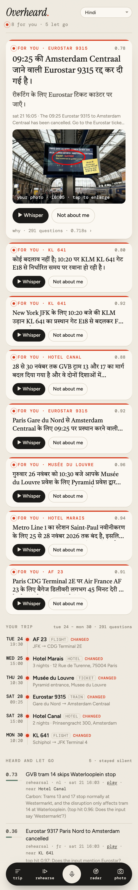
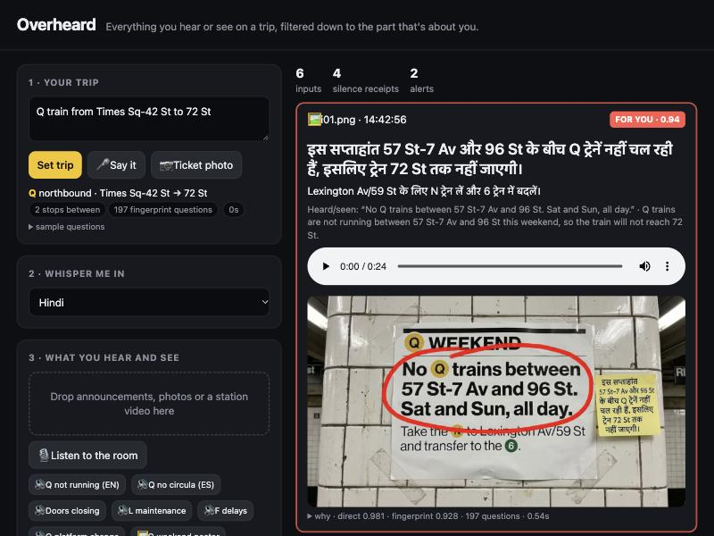
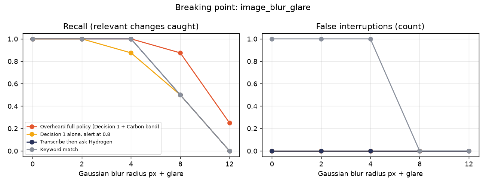

# Overheard

Everything you hear or see on a trip abroad, filtered down to the moments that touch your bookings.

Connect your inbox, or tap "Load demo trip". Overheard turns every booking (flights, hotels, trains, timed tickets) into one itinerary fingerprint: a few hundred yes/no questions, each tagged with the booking it protects. Before you fly, it sweeps French and Dutch news for strikes and closures on your dates, and it rehearses the announcements you are likely to hear. On the platform, every announcement, sign and board photo goes through the same `gemini-decision-1` call. Overheard speaks only when an input hits one of your bookings. It whispers the change in your language and shows proof: your photo with the line circled, or the quoted sentence from the source. Everything else leaves a silence receipt. Tap "not about me" on a wrong alert and it writes sharper questions for that booking.

Built at the Gemini 4 NYC Hackathon (Cerebral Valley and Google DeepMind, 2026-11-21). The engine was first built for the NYC subway in the afternoon (its results are further down), then extended to a whole trip to Paris and Amsterdam by an orchestrator session running eight ticket sessions in parallel.

<p></p>

## Overheard abroad: how it works

| Step | What happens | Model | Code |
|---|---|---|---|
| Bookings in | Gmail (read-only, `gmail.readonly`), pasted text, PDFs or screenshots become one itinerary | `gemini-4-neon` (thinking low) | `overheard/ingest.py`, `gmail.py` |
| Fingerprint | 40 to 54 questions per booking in French, Dutch and English, tagged `operator`, `place`, `change` or `combo`, plus one direct "does this hit booking X?" question per booking | `gemini-4-hydrogen` | `overheard/itinerary.py` |
| Score | One call per input answers every question at once; each booking gets its own score, so the verdict names which booking is hit | `gemini-decision-1` | `overheard/match.py` |
| Route | 0.8 or more alerts; 0.4 to 0.8 goes to Carbon, which sees the input and the booking; below 0.4 leaves a receipt | `gemini-4-carbon` | `overheard/abroad_alert.py` |
| Alert | Change and action extracted, translated, whispered; proof is the circled photo or the quoted line | Neon, Hydrogen, `gemini-3.8-flash-tts`, `gemini-nano-banana-2.1` | `overheard/abroad_alert.py` |
| Radar | Search-grounded sweep per booking and country, plus French and Dutch RSS; every URL fetched and checked; dates read by code | Hydrogen with Google Search | `overheard/radar.py` |
| Rehearsal | Likely announcements and signs per booking, half real hits and half near misses, voiced and drawn | Hydrogen, TTS, Nano Banana | `overheard/rehearsal.py` |
| Not about me | A dismissal becomes up to 3 `not` questions for that booking, kept only if they stay quiet on true alerts Hydrogen writes for the same booking | Hydrogen, Decision 1 | `overheard/learn.py` |

Per booking b: `s(b) = (0.3 x affects(b) + 0.7 x max(operator, place) x max(combo, change)) x (1 - not(b))`. News items score 0 for a booking when none of their dates fall in that booking's window. The full data model and API are in `SPEC.md`.

## Overheard abroad: results

Rerun with `.venv/bin/python eval/abroad_eval.py all` (cached verdicts in `eval/results/`, so a rerun takes seconds). 74 items scored against the 6-booking demo trip: 36 rehearsal items (24 voiced announcements, 12 drawn signs, labelled by construction) and 38 real news items the radar found on 2026-11-21 (labelled by the build agent, then reviewed by Carbon through Gemini CLI: 38 of 38 agreed).

| Source | Method | Caught | False alerts | Median latency |
|---|---|---|---|---|
| Rehearsal audio (12 relevant, 12 near misses) | Decision 1 at 0.8 | 10 of 12 | 2 of 12 | 0.93 s |
| | Full policy (Carbon on 0.4 to 0.8) | 12 of 12 | 2 of 12 | 2.6 s |
| | Transcribe, then ask Hydrogen | 12 of 12 | 0 of 12 | 6.5 s |
| | Keyword match (on the ground-truth scripts) | 12 of 12 | 10 of 12 | |
| Rehearsal signs (6 relevant, 6 near misses) | Decision 1 at 0.8 | 5 of 6 | 0 of 6 | 0.56 s |
| | Full policy | 6 of 6 | 1 of 6 | 2.3 s |
| | Read, then ask Hydrogen | 6 of 6 | 0 of 6 | 6.7 s |
| | Keyword match | 6 of 6 | 5 of 6 | |
| Real radar news (3 relevant, 35 not) | Decision 1 at 0.8 | 3 of 3 | 5 of 35 | 0.73 s |
| | Full policy | 3 of 3 | 6 of 35 | 0.76 s |
| | Ask Hydrogen | 3 of 3 | 7 of 35 | 4.1 s |
| | Keyword match | 2 of 3 | 11 of 35 | |

The numbers above are from the final cold run (4:17 PM, after the rehearsal clips were re-voiced without a spoken style prefix). An earlier run on the old clips had Decision 1 at 12 of 12 on audio, so expect a couple of items of run-to-run movement on sets this small.

What this shows:
- **Decision 1 is the fast path, Hydrogen is the accurate one.** On rehearsal data, transcribing and judging in text made no mistakes at 7 to 12 times the latency. Decision 1 alone caught 15 of 18 at under a second; with Carbon on the borderline band, the full policy caught 18 of 18.
- **Carbon earns its place on recall.** It rescued all 3 rehearsal misses (a French baggage sign for AF 23, a Louvre Pyramid closure, a Schiphol train outage before KL 641) and added 2 false alerts, one of them a structured answer that broke off mid-thought.
- **The near misses are hard on purpose.** "Eurostar 9317 cancelled; 9315 runs normally" scored 0.82 for the 9315 booking. Operator, route and cancellation all match, and only the number tells them apart. Keyword matching fires on almost every near miss.
- **Real news is thin on true hits.** Only 3 of 228 item and booking pairs were relevant, so recall on real news rests on 3 items. All 5 false alerts from Decision 1 on news were borderline: the right place and dates, with a change that misses the booking (a Louvre gallery closed for works, a metro skip one station away from the hotel).

### Learning from "not me"

- **Real MTA false alert (subway build).** "Manhattan-bound 7 skips 111 St..." scored 0.79 for a Flushing-bound rider. After one dismissal it scores 0.01, and the true "Flushing-bound 7 skips 52 St and 69 St" alert stays at 0.92 (`eval/learn_eval.py`).
- **Held out on the rehearsal set.** We dismiss 9 rehearsal near misses once each, then rescore the other 9 near misses and every true item. The first version hurt: true alerts at 0.8 fell from 17 to 6, because weak "not" answers around 0.2 on true alerts still lowered the score through `(1 - not)`. The fix counts a learned question only above 0.5, keeps at most 3 per dismissal, and drops date-limited questions. Two runs of the fixed version: true alerts 17 to 17 (Carbon band 8 to 6), and 15 to 14 with held-out false alerts 1 to 0 (the final run; one Amsterdam tram alert fell from 0.92 to 0.70). Learning now fixes the dismissed mistake without costing real alerts, but its benefit on unseen near misses is small. Diagnosis in `eval/results/abroad_learning_diag.json`.

### Honest failures (abroad)

- **Wrong booking on a near tie.** In one run a Paris line 8 closure alerted on the Eurostar (0.845) instead of the Paris hotel (0.843): the shared disruption questions and Paris place questions lift both.
- **Number-only near misses alert.** "KL 643 gate change; KL 641 departs on time" alerted in every run (0.80 to 0.89). It is visible in the screenshot above as the KL 641 card that says nothing changed. One "not about me" silences it.
- **Real news labels are few.** 3 relevant pairs is a weak recall test; we report it rather than pad it with synthetic news.
- **Latency outside Decision 1.** The verdict lands in about 1 s, the translated alert in about 10 s, the whisper by about 18 s and the circled photo by 25 to 35 s (Nano Banana takes 13 to 25 s).
- **Gmail is wired but was not demoed live.** The read-only OAuth client exists; the consent with the lab account is the remaining step, so the demo uses "Load demo trip" or pasted booking emails.

## Built with Gemini

Every Gemini call in the product is logged with model, prompt summary and latency (`logs/calls*.jsonl`). The build itself also used Gemini:

| Gemini model | What it built or did | Where |
|---|---|---|
| `gemini-4-hydrogen` through Gemini CLI (headless) | Wrote the 6 SAMPLE BOOKING emails (20 s) | `data/abroad/emails/` |
| `gemini-4-hydrogen` through Gemini CLI (headless) | Wrote all 36 rehearsal scripts with labels for 6 bookings (56 s, 0 of 36 labels needed fixing) | `data/abroad/rehearsal/scripts.json` |
| `gemini-4-carbon` through Gemini CLI (headless) | Reviewed every radar news label (38 of 38 agreed, 176 s) | `eval/abroad_labels.json` |
| `gemini-4-hydrogen` | Wrote both fingerprints (subway and itinerary) and the learned questions | `data/fingerprints/`, `data/abroad/fingerprints/` |
| `gemini-3.8-flash-tts`, `gemini-nano-banana-2.1` | Voiced and drew every synthetic announcement, sign and poster | `data/synth/`, `data/abroad/rehearsal/` |
| `antigravity-preview-09-2026` (Managed Agent) | Cut video highlight clips with ffmpeg in a hosted sandbox | `overheard/agent_clip.py` |

Gemini CLI measurements and lessons (for example: long `-p` prompts are ignored, pipe them on stdin) are in `GEMINI_MODEL_TESTS.md`. The application code was written by Claude Code sessions, one per ticket in `TICKETS.md`; `progress/` holds each ticket's report.

## Subway build: how it works

The engine was first built for one NYC subway trip. Tell it your trip, or show it your ticket; it listens to announcements, reads posters and countdown clocks, and scans a short station video.



One trip fingerprint is shared by every kind of input.

1. **Trip.** `gemini-4-neon` reads a typed route, a spoken route or a ticket photo and returns the line, direction, boarding and alighting stations, and every stop between (`overheard/trip.py`).
2. **Fingerprint.** `gemini-4-hydrogen` turns the trip into about 200 short yes/no questions in four groups: the rider's line, their stations, disruption types, and combinations such as "says Q trains are not stopping at 72 St?". It covers English and Spanish phrasings and spoken forms (`overheard/fingerprint.py`).
3. **Relevance.** `gemini-decision-1` answers the whole fingerprint plus one direct "does this affect the trip?" question on the raw input, in one call per input: an audio clip, a photo, or one frame of a video (`overheard/decide.py`). Relevance is 0.3 times the direct answer plus 0.7 times the fingerprint score, where the fingerprint score is the strongest line question times the strongest disruption or combination question.
4. **Routing.** At 0.8 or more, the input becomes an alert. From 0.4 to 0.8, `gemini-4-carbon` looks at the input and decides. Below 0.4, Overheard stays silent and writes a receipt, with a few-word gist from Hydrogen.
5. **Alert.** Neon extracts the exact change and the action, Hydrogen translates both, `gemini-3.8-flash-tts` whispers them, and `gemini-nano-banana-2.1` circles the line on the rider's photo (`overheard/alert.py`).
6. **Video.** One frame per second goes through the same Decision 1 call. The relevant seconds are cut into a captioned highlight clip with ffmpeg, first locally and then by a Gemini Managed Agent (`antigravity-preview-09-2026`) running ffmpeg in a hosted sandbox (`overheard/video.py`, `overheard/agent_clip.py`).
7. **Conflicts.** When two alerts disagree (a weekend poster says track 4, a live announcement says track 3), Carbon decides which source to trust and explains why.

| Model | Job | Median latency (from `logs/calls.jsonl`) |
|---|---|---|
| `gemini-decision-1` | Scores every input against the fingerprint | 0.77 s (516 calls) |
| `gemini-4-hydrogen` | Writes the fingerprint, translates, receipt gists, baseline | 2.4 s |
| `gemini-4-neon` (thinking `low`) | Trip extraction, change extraction | 5.9 s |
| `gemini-4-carbon` (thinking `low`) | Borderline inputs and conflicts | 4.0 s |
| `gemini-3.8-flash-tts` | Whispered alert | 4.5 s |
| `gemini-nano-banana-2.1` | Annotated photo, synthetic posters | 15 s |
| `antigravity-preview-09-2026` | Managed Agent that cuts the highlight clip with ffmpeg | 66 s |

## Subway build: results

All numbers come from `eval/` and can be rerun with `.venv/bin/python eval/run_eval.py all`, then `eval/policy.py` and `eval/extraction.py`. Each input is scored against 3 test trips (Q train Times Sq-42 St to 72 St, F train Jay St-MetroTech to 57 St, 7 train Grand Central to Flushing-Main St), so 24 announcements become 72 trip pairs.

### Main eval (clean inputs)

| Modality | Trip pairs | Relevant | Overheard full policy | Decision 1 alone at 0.8 | Transcribe, then ask Hydrogen | Keyword match |
|---|---|---|---|---|---|---|
| Audio | 72 | 11 | 11 of 11 caught, 0 false alerts | 11 of 11, 0 false | 11 of 11, 0 false | 10 of 11, 1 false |
| Images | 66 | 9 | 9 of 9 caught, 0 false alerts | 9 of 9, 0 false | 9 of 9, 0 false | 9 of 9, 4 false |
| Median latency per input | | | 0.8 s | 0.8 s | 4.6 s (audio), 5.2 s (images) | same as transcribe |

- Carbon reviewed the 25 pairs that landed between 0.4 and 0.8 and correctly silenced all of them. It took a median 4.6 s on audio and 3.4 s on images.
- Change extraction: Neon's extracted change and action were graded against the ground-truth script for all 19 relevant synthetic pairs. All 19 were graded correct (`eval/results/extraction.json`).
- Video: 4 synthetic 15 s walkthroughs (five signs each, one relevant sign in three of them) against 3 trips. All 3 relevant walkthroughs raised an alert and the highlight segment landed on the right sign each time; the 9 other pairs stayed silent. Each frame took a median 0.5 s (`eval/results/video.json`).

On clean inputs, the transcribe-then-ask baseline is just as accurate, at about six times the latency. Overheard's advantage there is speed and one engine for every modality, so the breaking-point charts are where the methods separate.

### Real MTA alerts (live feed, 2026-11-21 at 2:50 PM)

The demo's "Check live MTA alerts" button pulls the public MTA subway alerts feed and scores every alert on the rider's line through the same fingerprint. For the eval we scored all 33 alerts active at 2:50 PM against all 3 trips (99 pairs). The snapshot is in `data/real/mta_alerts_snapshot.json`. Two pairs are relevant under our rule: "Uptown A/C/F trains are running with delays" for the F trip, and "Flushing-bound 7 skips 52 St and 69 St" for the 7 trip. The build agent assigned these labels; they are listed in `eval/mta_eval.py`.

| Method | Caught | False alerts |
|---|---|---|
| Overheard full policy | 2 of 2 | 1 |
| Hydrogen reads the alert text | 2 of 2 | 0 |
| Keyword match | 2 of 2 | 4 |

The one false alert was "Manhattan-bound 7 skips 111 St, 103 St, 90 St and 82 St; all trains at Junction Blvd board from the Flushing-bound platform", for the Flushing-bound rider. Decision 1 scored it 0.79 and Carbon then said relevant, probably misled by "Flushing-bound platform". That is the direction weakness below, on real data. Decision 1 took a median 0.6 s per alert.

### Breaking points

Each chart uses every relevant (input, trip) pair plus the same number of non-relevant pairs (22 audio pairs, 16 image pairs) and degrades the input step by step. Audio gets real subway train and platform noise from Wikimedia Commons recordings, mixed in at a falling signal-to-noise ratio. Images get Gaussian blur plus a glare patch. "Full policy" means alert at 0.8, Carbon on 0.4 to 0.8.

| Audio, SNR | Clean | 10 dB | 5 dB | 0 dB | -5 dB | -10 dB |
|---|---|---|---|---|---|---|
| Overheard full policy | 11/11 | 11/11 | 11/11 | 11/11 | 10/11 | 11/11 |
| Decision 1 alone at 0.8 | 11/11 | 10/11 | 10/11 | 9/11 | 7/11 | 4/11 |
| Transcribe, then ask Hydrogen | 11/11 | 11/11 | 11/11 | 11/11 | 11/11 | 11/11 |
| Keyword match | 10/11 | 10/11 | 10/11 | 10/11 | 10/11 | 9/11 |
| Pairs sent to Carbon | 3 | 5 | 5 | 8 | 15 | 17 |

| Images, blur radius | 0 | 2 px | 4 px | 8 px | 12 px |
|---|---|---|---|---|---|
| Overheard full policy | 8/8 | 8/8 | 8/8 | **7/8** | **2/8** |
| Decision 1 alone at 0.8 | 8/8 | 8/8 | 7/8 | 4/8 | 0/8 |
| Transcribe, then ask Hydrogen | 8/8 | 8/8 | 8/8 | 4/8 | 0/8 |
| Keyword match | 8/8, 1 false | 8/8, 1 false | 8/8, 1 false | 4/8 | 0/8 |

No method raised a false alert at any level except keyword matching on clean images. The text-baseline line is hidden under the keyword line in the blur chart because their recall is identical.

What this shows:
- **Blurry and glared signs are where Overheard wins.** Scoring the image directly holds on to signs that OCR can no longer read: at blur 8 the full policy catches 7 of 8 against 4 of 8 for both text baselines.
- **On noisy audio, transcription is stronger than Decision 1 alone.** Hydrogen transcribed every announcement correctly even at -10 dB, while Decision 1's scores sank into the borderline band. Overheard's full policy keeps up only because Carbon reviews those pairs (17 of 22 at -10 dB, about 4 s each), so in heavy noise Overheard loses most of its speed advantage.




### Honest failures and caveats

- **Mostly synthetic media.** Announcements are voiced by Gemini TTS and posters are drawn by Nano Banana, which makes the labels exact but the inputs cleaner than a real platform. Wikimedia Commons has no real NYC subway PA announcements, so the real audio we found (6 clips of train and platform noise) is used as the noise bed for the audio chart. One real multilingual 7 train poster and three other real signs are in the image eval, and the 7 train poster was caught for the Flushing trip.
- **The 0.3/0.7 weighting was picked on the same eval set.** With equal weights, the direct question let through false alerts on Spanish and L-train announcements (an L train announcement scored 0.96 on the direct question for the 7 train trip). The set is small (11 relevant audio pairs, 9 image pairs), so treat the perfect clean scores as an upper bound.
- **Look-alike station names.** Hydrogen's station questions fire on near names ("52 St" for "59 Street"). Gating the fingerprint score on the rider's line fixes this in the eval, but a trip with a common station name on several lines would still be at risk.
- **Direction is weak.** "Manhattan-bound 7 trains are running on schedule" scored 0.66 for the Flushing-bound 7 trip. It lands in the borderline band, so Carbon has to catch it, which costs about 4 s. On the live MTA feed, Carbon missed one such case (see above).
- **Noise.** At -5 dB one relevant announcement (relevance 0.55) went to Carbon, and Carbon said no. Real platforms often sit around 0 to -5 dB during a train arrival, so this is the realistic failure zone. A sensible next step would be to route low-confidence audio to transcription instead of to Carbon.
- **Latency outside Decision 1.** The first whisper arrives about 10 s after the input (Neon extraction plus Hydrogen translation plus TTS), and the annotated photo about 10 to 15 s later. Decision 1 itself is under a second when inputs are shrunk to 16 kHz mono mp3 or 1024 px JPEG; sending the full-size files made it 3 to 8 times slower.

## Run it

```bash
uv venv .venv && uv pip install --python .venv/bin/python google-genai fastapi uvicorn python-multipart pillow numpy matplotlib python-dotenv httpx feedparser pytest google-auth-oauthlib google-api-python-client
echo "GEMINI_API_KEY=your-key" > .env
.venv/bin/uvicorn server:app --port 8000
```

- **Trip abroad on a phone:** run `cloudflared tunnel --url http://localhost:8000` (no account needed), open the printed `https://...trycloudflare.com/abroad` on your phone, tap "trip" to load the demo trip, then "rehearse", "radar", the mic or the photo button. `OVERHEARD_FIXTURE=1` serves a canned feed with no API calls.
- **Subway demo:** open http://localhost:8000, set a trip, pick a whisper language, then drop files or use the sample buttons. ffmpeg must be on the PATH.
- **Gmail (optional):** create a Desktop OAuth client with scope `gmail.readonly`, save it as `secrets/gmail_client.json` (gitignored), add your inbox as a test user, then run `.venv/bin/python -m overheard.gmail --fetch --parse` once to consent.
- **Tests and evals:** `.venv/bin/python -m pytest tests -q`, `eval/abroad_eval.py all`, `eval/learn_eval.py`, and the subway evals below.

## Repo map

- `SPEC.md` (data model and API), `TICKETS.md` (how the build was split), `GLOSSARY.md` (the words), `progress/` (one report per ticket).
- Abroad: `overheard/itinerary.py`, `match.py`, `ingest.py`, `gmail.py`, `radar.py`, `rehearsal.py`, `learn.py`, `abroad_alert.py`, `api_abroad.py`; page in `web/abroad/`; data in `data/abroad/`; eval in `eval/abroad_eval.py`.

- `overheard/config.py`: every model ID and threshold.
- `overheard/gemini.py`: shared client; logs model, prompt summary and latency for every call to `logs/calls.jsonl`.
- `overheard/trip.py`, `fingerprint.py`, `decide.py`, `alert.py`, `video.py`, `agent_clip.py`: one file per step.
- `server.py`, `web/index.html`: the demo.
- `data/spec.py`: the labeled scripts and poster texts; `data/labels.json` is generated from it. `data/real/SOURCES.json` lists the real Commons files with their licenses and authors.
- `eval/`: harness, results and charts. `DEMO.md`: the 1-minute video script.

## Data licenses

Synthetic audio and images were generated with Gemini models for this project. Real images and audio come from Wikimedia Commons under CC BY, CC BY-SA, CC0 or public domain licenses; `data/real/SOURCES.json` credits each file.
