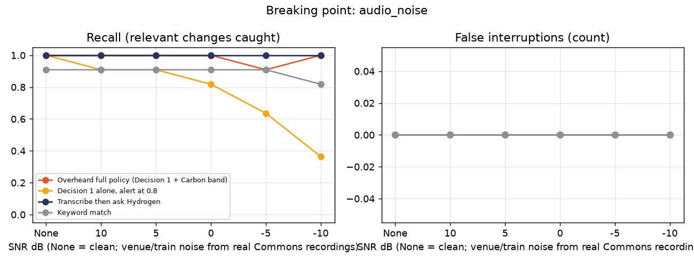

# Overheard

Everything you hear or see on a trip, filtered down to the part that's about you.

Tell Overheard your subway trip, or show it your ticket. It listens to station announcements, reads posters and countdown clocks, and scans a short video of the station. It stays quiet about everything that doesn't touch your trip, and when something does, it whispers the change in your language and hands back your own photo with that one line circled and translated. Every input it ignores leaves a silence receipt with a relevance score, so you can see why it kept quiet.

Built solo in one afternoon at the Gemini 4 NYC Hackathon (Cerebral Valley and Google DeepMind, 2026-11-21) for the Element 119 problem: messy real-world audio, images and video, pushed until they break.


## How it works

One trip fingerprint is shared by every kind of input.

1. **Trip.** `gemini-4-neon` reads a typed route, a spoken route or a ticket photo and returns the line, direction, boarding and alighting stations, and every stop between (`overheard/trip.py`).
2. **Fingerprint.** `gemini-4-hydrogen` turns the trip into about 200 short yes/no questions in four groups: the rider's line, their stations, disruption types, and combinations such as "says Q trains are not stopping at 72 St?". It covers English and Spanish phrasings and spoken forms (`overheard/fingerprint.py`).
3. **Relevance.** `gemini-decision-1` answers the whole fingerprint plus one direct "does this affect the trip?" question on the raw input, in one call per input: an audio clip, a photo, or one frame of a video (`overheard/decide.py`). Relevance is 0.3 times the direct answer plus 0.7 times the fingerprint score, where the fingerprint score is the strongest line question times the strongest disruption or combination question.
4. **Routing.** At 0.8 or more, the input becomes an alert. From 0.4 to 0.8, `gemini-4-carbon` looks at the input and decides. Below 0.4, Overheard stays silent and writes a receipt, with a few-word gist from Hydrogen.
5. **Alert.** Neon extracts the exact change and the action, Hydrogen translates both, `gemini-3.8-flash-tts` whispers them, and `gemini-nano-banana-2.1` circles the line on the rider's photo (`overheard/alert.py`).
6. **Video.** One frame per second goes through the same Decision 1 call. The relevant seconds are cut into a captioned highlight clip with ffmpeg, first locally and then by a Gemini Managed Agent (`antigravity-preview-09-2026`) running ffmpeg in a hosted sandbox (`overheard/video.py`, `overheard/agent_clip.py`).
7. **Conflicts.** When two alerts disagree (a weekend poster says track 4, a live announcement says track 3), Carbon decides which source to trust and explains why.

| Model | Job | Median latency (from `logs/calls.jsonl`) |
|---|---|---|
| `gemini-decision-1` | Scores every input against the fingerprint | 0.77 s (516 calls) |
| `gemini-4-hydrogen` | Writes the fingerprint, translates, receipt gists, baseline | 2.4 s |
| `gemini-4-neon` (thinking `low`) | Trip extraction, change extraction | 5.9 s |
| `gemini-4-carbon` (thinking `low`) | Borderline inputs and conflicts | 4.0 s |
| `gemini-3.8-flash-tts` | Whispered alert | 4.5 s |
| `gemini-nano-banana-2.1` | Annotated photo, synthetic posters | 15 s |
| `antigravity-preview-09-2026` | Managed Agent that cuts the highlight clip with ffmpeg | 66 s |

## Results

All numbers come from `eval/` and can be rerun with `.venv/bin/python eval/run_eval.py all`, then `eval/policy.py` and `eval/extraction.py`. Each input is scored against 3 test trips (Q train Times Sq-42 St to 72 St, F train Jay St-MetroTech to 57 St, 7 train Grand Central to Flushing-Main St), so 24 announcements become 72 trip pairs.

### Main eval (clean inputs)

| Modality | Trip pairs | Relevant | Overheard full policy | Decision 1 alone at 0.8 | Transcribe, then ask Hydrogen | Keyword match |
|---|---|---|---|---|---|---|
| Audio | 72 | 11 | 11 of 11 caught, 0 false alerts | 11 of 11, 0 false | 11 of 11, 0 false | 10 of 11, 1 false |
| Images | 66 | 9 | 9 of 9 caught, 0 false alerts | 9 of 9, 0 false | 9 of 9, 0 false | 9 of 9, 4 false |
| Median latency per input | | | 0.8 s | 0.8 s | 4.6 s (audio), 5.2 s (images) | same as transcribe |

- Carbon reviewed the 25 pairs that landed between 0.4 and 0.8 and correctly silenced all of them. It took a median 4.6 s on audio and 3.4 s on images.
- Change extraction: Neon's extracted change and action were graded against the ground-truth script for all 19 relevant synthetic pairs. All 19 were graded correct (`eval/results/extraction.json`).
- Video: 4 synthetic 15 s walkthroughs (five signs each, one relevant sign in three of them) against 3 trips. All 3 relevant walkthroughs raised an alert and the highlight segment landed on the right sign each time; the 9 other pairs stayed silent. Each frame took a median 0.5 s (`eval/results/video.json`).

On clean inputs, the transcribe-then-ask baseline is just as accurate, at about six times the latency. Overheard's advantage there is speed and one engine for every modality, so the breaking-point charts are where the methods separate.

### Breaking points

Each chart uses every relevant (input, trip) pair plus the same number of non-relevant pairs (22 audio pairs, 16 image pairs) and degrades the input step by step. Audio gets real subway train and platform noise from Wikimedia Commons recordings, mixed in at a falling signal-to-noise ratio. Images get Gaussian blur plus a glare patch. "Full policy" means alert at 0.8, Carbon on 0.4 to 0.8.

| Audio, SNR | Clean | 10 dB | 5 dB | 0 dB | -5 dB | -10 dB |
|---|---|---|---|---|---|---|
| Overheard full policy | 11/11 | 11/11 | 11/11 | 11/11 | 10/11 | 11/11 |
| Decision 1 alone at 0.8 | 11/11 | 10/11 | 10/11 | 9/11 | 7/11 | 4/11 |
| Transcribe, then ask Hydrogen | 11/11 | 11/11 | 11/11 | 11/11 | 11/11 | 11/11 |
| Keyword match | 10/11 | 10/11 | 10/11 | 10/11 | 10/11 | 9/11 |
| Pairs sent to Carbon | 3 | 5 | 5 | 8 | 15 | 17 |

| Images, blur radius | 0 | 2 px | 4 px | 8 px | 12 px |
|---|---|---|---|---|---|
| Overheard full policy | 8/8 | 8/8 | 8/8 | **7/8** | **2/8** |
| Decision 1 alone at 0.8 | 8/8 | 8/8 | 7/8 | 4/8 | 0/8 |
| Transcribe, then ask Hydrogen | 8/8 | 8/8 | 8/8 | 4/8 | 0/8 |
| Keyword match | 8/8, 1 false | 8/8, 1 false | 8/8, 1 false | 4/8 | 0/8 |

No method raised a false alert at any level except keyword matching on clean images. The text-baseline line is hidden under the keyword line in the blur chart because their recall is identical.

What this shows:
- **Blurry and glared signs are where Overheard wins.** Scoring the image directly holds on to signs that OCR can no longer read: at blur 8 the full policy catches 7 of 8 against 4 of 8 for both text baselines.
- **On noisy audio, transcription is stronger than Decision 1 alone.** Hydrogen transcribed every announcement correctly even at -10 dB, while Decision 1's scores sank into the borderline band. Overheard's full policy keeps up only because Carbon reviews those pairs (17 of 22 at -10 dB, about 4 s each), so in heavy noise Overheard loses most of its speed advantage.




### Honest failures and caveats

- **Mostly synthetic data.** Announcements are voiced by Gemini TTS and posters are drawn by Nano Banana, which makes the labels exact but the inputs cleaner than a real platform. Wikimedia Commons has no real NYC subway PA announcements, so the real audio we found (6 clips of train and platform noise) is used as the noise bed for the audio chart. One real multilingual 7 train poster and three other real signs are in the image eval, and the 7 train poster was caught for the Flushing trip.
- **The 0.3/0.7 weighting was picked on the same eval set.** With equal weights, the direct question let through false alerts on Spanish and L-train announcements (an L train announcement scored 0.96 on the direct question for the 7 train trip). The set is small (11 relevant audio pairs, 9 image pairs), so treat the perfect clean scores as an upper bound.
- **Look-alike station names.** Hydrogen's station questions fire on near names ("52 St" for "59 Street"). Gating the fingerprint score on the rider's line fixes this in the eval, but a trip with a common station name on several lines would still be at risk.
- **Direction is weak.** "Manhattan-bound 7 trains are running on schedule" scored 0.66 for the Flushing-bound 7 trip. It lands in the borderline band, so Carbon has to catch it, which costs about 4 s.
- **Noise.** At -5 dB one relevant announcement (relevance 0.55) went to Carbon, and Carbon said no. Real platforms often sit around 0 to -5 dB during a train arrival, so this is the realistic failure zone. A sensible next step would be to route low-confidence audio to transcription instead of to Carbon.
- **Latency outside Decision 1.** The first whisper arrives about 10 s after the input (Neon extraction plus Hydrogen translation plus TTS), and the annotated photo about 10 to 15 s later. Decision 1 itself is under a second when inputs are shrunk to 16 kHz mono mp3 or 1024 px JPEG; sending the full-size files made it 3 to 8 times slower.

## Run it

```bash
uv venv .venv && uv pip install --python .venv/bin/python google-genai fastapi uvicorn python-multipart pillow numpy matplotlib python-dotenv httpx
echo "GEMINI_API_KEY=your-key" > .env
.venv/bin/uvicorn server:app --port 8000
```

Open http://localhost:8000, set a trip, pick a whisper language, then drop files or use the sample buttons. ffmpeg must be on the PATH. Regenerate the synthetic set with `.venv/bin/python data/generate.py` and `data/make_videos.py`.

## Repo map

- `overheard/config.py`: every model ID and threshold.
- `overheard/gemini.py`: shared client; logs model, prompt summary and latency for every call to `logs/calls.jsonl`.
- `overheard/trip.py`, `fingerprint.py`, `decide.py`, `alert.py`, `video.py`, `agent_clip.py`: one file per step.
- `server.py`, `web/index.html`: the demo.
- `data/spec.py`: the labeled scripts and poster texts; `data/labels.json` is generated from it. `data/real/SOURCES.json` lists the real Commons files with their licenses and authors.
- `eval/`: harness, results and charts. `DEMO.md`: the 1-minute video script.

## Data licenses

Synthetic audio and images were generated with Gemini models for this project. Real images and audio come from Wikimedia Commons under CC BY, CC BY-SA, CC0 or public domain licenses; `data/real/SOURCES.json` credits each file.
